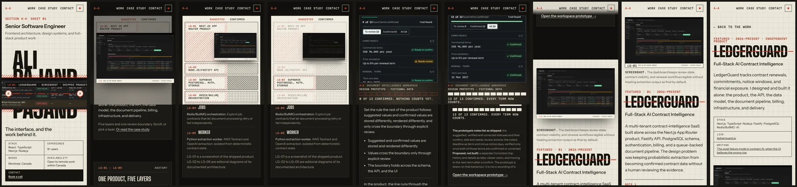
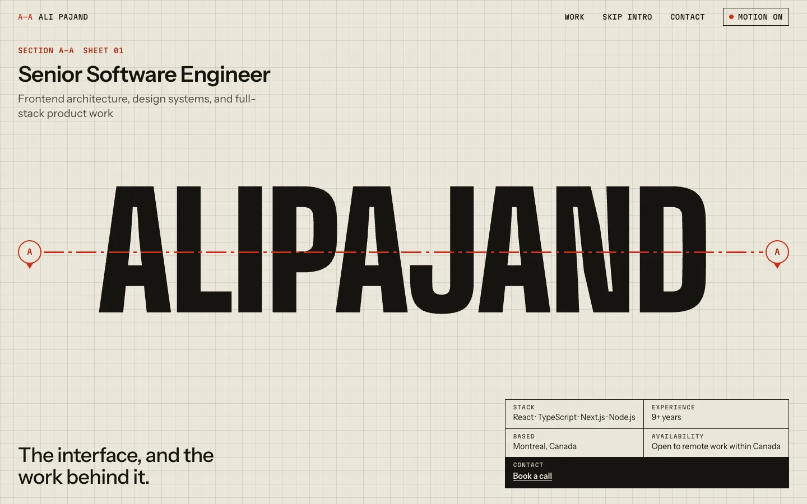
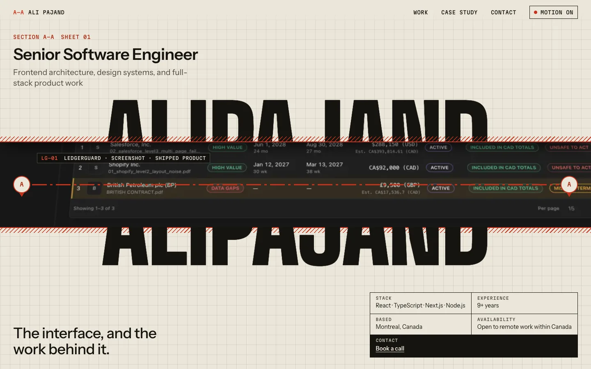
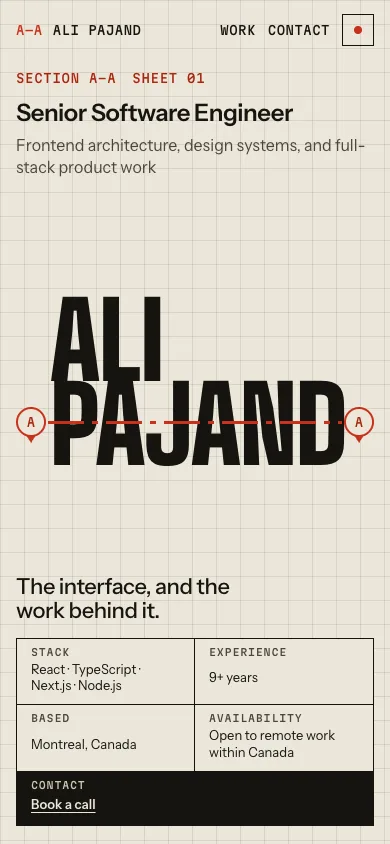
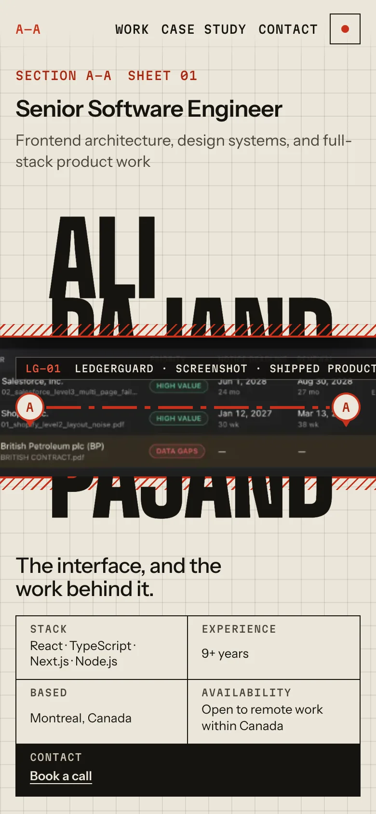

# Storyboard

Revision 2. Four beats replace the first proof's opening, transformation and descent. Frames are real captures of the prototype in Chromium at 1440×900 (desktop) and 390×844 (mobile, 2× pixels), taken at the scroll position named in each row. The sequence is 4.5 viewport heights on desktop and 3.9 on mobile; timings are in [04-motion-spec.md](04-motion-spec.md).

## The first frame

| Before                                                          | After                                                      |
| --------------------------------------------------------------- | ---------------------------------------------------------- |
|  |  |
|    |    |

**Before**, the cover was a closed sheet of paper: the name, a red section line and a title block. The interface appeared only after the reader had scrolled about one viewport and waited for the halves to part.

**After**, the same cover arrives already cut open. The aperture through the name shows a close crop of the shipped dashboard's contract table, tipped back 22° so it reads as something behind the page. That crop carries real rows, status chips and the red-and-amber "unsafe to act" column. A tag inside the cut names it: **LG-01 · LedgerGuard · Screenshot · shipped product**. Everything a recruiter needs is in the frame: "Senior Software Engineer", the focus line, the thesis, and the title block (stack, experience, location, availability, Book a call).

The cut is drawn in CSS with no script, so it is the frame with JavaScript off, with reduced motion, and before GSAP loads. When the sequence activates, it starts from the same pose, read back from CSS, and the stage does not move. The only arrival motion is the section line drawing in and the "A" markers landing, 600 ms in all, over content that is already there.

## Beat A · The cut reveals the interface

| Frame                                                                                                                | What happens                                                                                                                                                                                                                                                                                                                                                                                                                                |
| -------------------------------------------------------------------------------------------------------------------- | ------------------------------------------------------------------------------------------------------------------------------------------------------------------------------------------------------------------------------------------------------------------------------------------------------------------------------------------------------------------------------------------------------------------------------------------- |
| [desktop-02-a-interface](screenshots/desktop-02-a-interface.webp) · [mobile](screenshots/mobile-02-a-interface.webp) | The paper halves part and the crop pulls back, untilting, into the whole screenshot: flat, labelled on its own title strip "LG-01 · Next.js App Router product · Screenshot · shipped product". On desktop it moves left of the reading column. On mobile it fills a window across the top of the screen, and the text reads beneath. The intro card (LedgerGuard, independent product, designed and built end to end) scrolls up natively. |

## Beat B · The anatomy

| Frame                                                                                                                      | What happens                                                                                                                                                                                                                                                                                                                                                                                            |
| -------------------------------------------------------------------------------------------------------------------------- | ------------------------------------------------------------------------------------------------------------------------------------------------------------------------------------------------------------------------------------------------------------------------------------------------------------------------------------------------------------------------------------------------------- |
| [desktop-03-b-anatomy](screenshots/desktop-03-b-anatomy.webp) · [mobile](screenshots/mobile-03-b-anatomy.webp)             | **Desktop:** one tilt separates the screenshot from four editorial-diagram sheets beneath it (LG-02 API, LG-03 data, LG-04 jobs, LG-05 worker), and each drawing inks in as the list beside it is read. **Mobile:** not the desktop stack made smaller. A drawn section of five horizontal bands with drafting hatches; the screenshot settles into band LG-01, and bands 2 to 5 are drawn in under it. |
| [desktop-04-b-layer-focus](screenshots/desktop-04-b-layer-focus.webp) · [mobile](screenshots/mobile-04-b-layer-focus.webp) | **The five layers stay facts.** The card is a list of five buttons, one per layer, each with its one-line fact. Pressing one lifts that sheet (or band) in red and dims the rest; pressing it again puts it back. The list is the explorer and the anatomy is its picture, so nobody has to scroll five steps to read five facts. Layers not yet drawn are greyed in the list while the sequence plays. |

## Beat C · The verification boundary

| Frame                                                                                                                | What happens                                                                                                                                                                                                                                                                                                                                                                                                                                                                                                                                   |
| -------------------------------------------------------------------------------------------------------------------- | ---------------------------------------------------------------------------------------------------------------------------------------------------------------------------------------------------------------------------------------------------------------------------------------------------------------------------------------------------------------------------------------------------------------------------------------------------------------------------------------------------------------------------------------------- |
| [desktop-05-c-boundary](screenshots/desktop-05-c-boundary.webp) · [mobile](screenshots/mobile-05-c-boundary.webp)    | The red cut returns as the product's rule. On desktop a red hatched plane rises through every sheet; on mobile a red line drops through every band, splitting each into "suggested" and "confirmed". Then the Document Intelligence Workspace slides over it. It is labelled "A–A · Document Intelligence Workspace · **Design prototype · fictional data**" in a dashed frame. On mobile it is cropped to its review list so the terms can be read. State: Ready for review. The tally beneath reads "0 of 13 confirmed. Nothing counts yet." |
| [desktop-06-c-confirmed](screenshots/desktop-06-c-confirmed.webp) · [mobile](screenshots/mobile-06-c-confirmed.webp) | Scrolling on plays the states: Partially reviewed ("6 of 13 confirmed. Only those count."), then Confirmed ("13 of 13 confirmed. Every term now counts."). The visible consequence is the tally: 13 dashed red ticks turn solid as terms cross the boundary, so the state change reads even when the workspace image is small. The card's three buttons pick a state by hand, and "Open the workspace prototype" goes to the interactive prototype.                                                                                            |

## Beat D · Resolution into the case study

| Frame                                                                                                                | What happens                                                                                                                                                                                                                                                                                                                                                                                                                                                                   |
| -------------------------------------------------------------------------------------------------------------------- | ------------------------------------------------------------------------------------------------------------------------------------------------------------------------------------------------------------------------------------------------------------------------------------------------------------------------------------------------------------------------------------------------------------------------------------------------------------------------------ |
| [desktop-07-d-match-cut](screenshots/desktop-07-d-match-cut.webp) · [mobile](screenshots/mobile-07-d-match-cut.webp) | **The match cut.** The diagram sheets close onto the screenshot and fade. The one shipped screenshot, which has been on screen since the first frame, flattens and travels into the story's figure while the dark interior fades to the story's paper. Its scale and framing change; it is never swapped for a different image in transit.                                                                                                                                     |
| [desktop-08-d-landed](screenshots/desktop-08-d-landed.webp) · [mobile](screenshots/mobile-08-d-landed.webp)          | **Landed.** The screenshot meets the figure 87 px before the end of the sequence on desktop (234 px on mobile) and rises with the page, so the two are one object. At the end of the timeline the story's own `<figure>` takes over at the same position and size, and the stage lets go. The figure now opens the story on every width: left column on desktop, above the heading on mobile. Then come the heading, problem, decisions and "Read the LedgerGuard case study". |
| [desktop-09-case-study](screenshots/desktop-09-case-study.webp) · [mobile](screenshots/mobile-09-case-study.webp)    | `ledgerguard.html`. The same screenshot is the case-study hero, and a cross-document view transition morphs it from the story's figure (`lg-shot`, 520 ms) in browsers that support it.                                                                                                                                                                                                                                                                                        |

The match cut is demonstrated, not described: [04-match-cut.mp4](recordings/04-match-cut.mp4) and [mobile-match-cut.mp4](recordings/mobile-match-cut.mp4). A probe of the screenshot's rectangle against the figure's, taken every 1% of the last fifth of the timeline, shows them identical from 98% (desktop) and 94% (mobile) to the end. The data is in [06-review.md](06-review.md#match-cut-measurement).

## Reduced motion and the static page

| Frame                                                                                                                                     | What it shows                                                                                                                                                           |
| ----------------------------------------------------------------------------------------------------------------------------------------- | ----------------------------------------------------------------------------------------------------------------------------------------------------------------------- |
| [desktop-10-static-first-frame](screenshots/desktop-10-static-first-frame.webp) · [mobile](screenshots/mobile-10-static-first-frame.webp) | The same cut-open cover, without the draw-in.                                                                                                                           |
| [desktop-11-static-anatomy](screenshots/desktop-11-static-anatomy.webp) · [mobile](screenshots/mobile-11-static-anatomy.webp)             | The anatomy as a static drawn section: five bands with the screenshot in LG-01 and the red boundary line through all of them. The same five layer buttons focus a band. |
| [desktop-12-static-boundary](screenshots/desktop-12-static-boundary.webp) · [mobile](screenshots/mobile-12-static-boundary.webp)          | The boundary card carries the workspace prototype inline, with its state buttons and tally, which switch instantly.                                                     |

Recording: [reduced-motion.mp4](recordings/reduced-motion.mp4).

## Navigation contract

| Need                           | How                                                                                                                                                                                          |
| ------------------------------ | -------------------------------------------------------------------------------------------------------------------------------------------------------------------------------------------- |
| Reach the case study now       | The bar's **Case study** link, visible in every frame, goes straight to `ledgerguard.html`. The intro card also links to it.                                                                 |
| Skip the sequence              | First Tab stop: "Skip to the LedgerGuard story" goes to `#project-ledgerguard`.                                                                                                              |
| Reach the work or contact      | Bar **Work** goes to `#work` and **Contact** to `#contact`.                                                                                                                                  |
| Read a layer without scrolling | The five layer buttons in the anatomy card                                                                                                                                                   |
| Return without losing context  | Browser **Back** restores the scroll position and skips the arrival animation. The case study's back link goes to `index.html#project-ledgerguard`. Both were tested with motion on and off. |
| Turn motion off                | Bar **Motion on/off** toggle (`aria-pressed`). It follows `prefers-reduced-motion` until the visitor chooses, and a later OS switch to reduced motion overrides an earlier "on".             |
