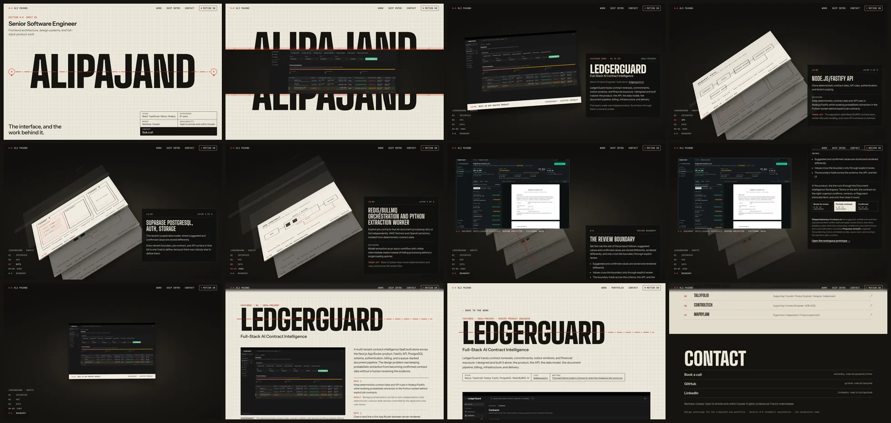

# Cinematic exploration: Section A–A

> **This exploration replaces the three P1 concepts in [#214](https://github.com/alipajand/alipajand/pull/214)** (A Editorial, B Interface Atlas, C Systems in Motion), which were rejected. None of them was used as a template. #214 is left unchanged and unmerged.
>
> Design artefact only. No production code, dependency, configuration, token or content changes. No production implementation is authorised.

**Proposition:** THE WORK BEHIND THE INTERFACE.

**Concept:** the portfolio is a drawing set. The name is cut by a section line, A–A. Scrolling makes the cut and reveals the real LedgerGuard interface behind the page. The camera tilts into an exploded view of the system's layers, one sheet per layer. A red plane, the review boundary, cuts through all of them, and uncovers where that rule lives in the product: the Document Intelligence Workspace, from LedgerGuard's design prototype with fictional data. Then the set closes into a readable project story and the full case study.

> **Provenance.** Three materials, always labelled: the shipped product (screenshots, solid frame), editorial diagrams (paper), and **design prototypes with fictional data** (dashed frame). No prototype is presented as a shipped screenshot.



## Deliverables

| #   | Deliverable                                    | Where                                                                                                                                                               |
| --- | ---------------------------------------------- | ------------------------------------------------------------------------------------------------------------------------------------------------------------------- |
| 1   | Research (five references)                     | [01-research.md](01-research.md)                                                                                                                                    |
| 2   | Concept statement                              | [02-concept.md](02-concept.md)                                                                                                                                      |
| 3   | Storyboard                                     | [03-storyboard.md](03-storyboard.md), [storyboard-desktop.webp](screenshots/storyboard-desktop.webp), [storyboard-mobile.webp](screenshots/storyboard-mobile.webp)  |
| 4   | Opening composition                            | [02-concept.md § Scene 01](02-concept.md#scene-01-opening-composition)                                                                                              |
| 5   | Working prototype                              | [`prototype/`](prototype/): `index.html` and `ledgerguard.html`                                                                                                     |
| 6   | LedgerGuard transformation                     | Scenes 02 and 03 in [03-storyboard.md](03-storyboard.md); the review boundary in the product: [§ The project interaction](03-storyboard.md#the-project-interaction) |
| 7   | Motion specification                           | [04-motion-spec.md](04-motion-spec.md)                                                                                                                              |
| 8   | Desktop recording (uninterrupted, ~30 s)       | [recordings/desktop-full.mp4](recordings/desktop-full.mp4)                                                                                                          |
| 9   | Mobile recording                               | [recordings/mobile-full.mp4](recordings/mobile-full.mp4)                                                                                                            |
| 10  | Desktop and mobile screenshots                 | [`screenshots/`](screenshots/)                                                                                                                                      |
| 11  | Reduced-motion fallback                        | [recordings/reduced-motion.mp4](recordings/reduced-motion.mp4), `screenshots/reduced-*`                                                                             |
| 12  | Technical feasibility                          | [05-feasibility-and-performance.md](05-feasibility-and-performance.md)                                                                                              |
| 13  | Performance-risk assessment                    | [05-feasibility-and-performance.md](05-feasibility-and-performance.md#performance-risks)                                                                            |
| —   | Creative and functional review, open decisions | [06-review.md](06-review.md)                                                                                                                                        |

### Motion segments

All four are cut from the uninterrupted desktop take.

1. [01-opening.mp4](recordings/01-opening.mp4): initial scene, arrival and cut opening
2. [02-into-the-project.mp4](recordings/02-into-the-project.mp4): scrolling into LedgerGuard, the tilt and the descent through the layers
3. [03-boundary-interaction.mp4](recordings/03-boundary-interaction.mp4): the red plane uncovers the Document Intelligence Workspace (design prototype, fictional data); scrolling plays its review states, then the reader picks states by hand
4. [04-transition-to-detail.mp4](recordings/04-transition-to-detail.mp4): collapse, story, view transition into the case study, and back
5. [reduced-motion.mp4](recordings/reduced-motion.mp4): the same journey with `prefers-reduced-motion: reduce`

## Run it locally

The prototype is static HTML, CSS and JS. GSAP 3.12.5 and ScrollTrigger load from cdnjs, and fonts from Google Fonts. No install is needed. Run these from this folder:

```bash
python3 -m http.server 4417 --directory prototype
```

Then open <http://localhost:4417/index.html>. The interactive workspace prototype is at <http://localhost:4417/workspace.html>; it loads React 18.3.1 and htm 3.1.1 from jsDelivr.

### Rebuild the pages from project data

`prototype/build.mjs` reads `data/projects.ts` and writes `index.html` and `ledgerguard.html`. It needs Node 23.6 or later, which strips TypeScript types without a flag.

```bash
node prototype/build.mjs
```

Then format the generated pages, which `pnpm format:check` covers:

```bash
pnpm exec prettier --write prototype
```

### Capture, review and record

The capture scripts use `playwright-core` and `axe-core`. **They are deliberately not project dependencies.** Install them anywhere outside the repo and point `NODE_PATH` and `CHROME_PATH` at them:

```bash
npm install --prefix /tmp/aa-tools playwright-core axe-core
```

```bash
NODE_PATH=/tmp/aa-tools/node_modules CHROME_PATH="/path/to/chrome" node capture/review.mjs
```

| Script                                                                         | Output                                                                                                                |
| ------------------------------------------------------------------------------ | --------------------------------------------------------------------------------------------------------------------- |
| `capture/review.mjs [out.json]`                                                | Functional review: axe, keyboard, workspace states, Back, reduced motion, overflow                                    |
| `capture/record.mjs recordings desktop\|mobile\|reduce`                        | Screencast → mp4 with ffmpeg (desktop also writes the four segments)                                                  |
| `capture/frames.mjs <dir> <w> <h> <full\|reduce> <positions…>`                 | Still frames at element ids, viewport multiples, or `ws-<fraction>` through the workspace states                      |
| `capture/prototype-states.mjs <prototype.html> <dir> <name>=<Label>:<value>,…` | Captures a design prototype's states by driving its review bar (run against `workspace.html`); WebP via `cwebp -q 80` |
| `capture/perf.mjs`                                                             | Delivered bytes and frame pacing probe                                                                                |

## Files

```
cinematic-exploration/
├─ README.md, 01–06 *.md           documentation
├─ prototype/
│  ├─ build.mjs                    page generator (reads data/projects.ts)
│  ├─ drawings.mjs                 editorial SVG diagrams for sheets LG-02 to LG-05
│  ├─ index.html, ledgerguard.html generated pages
│  ├─ styles.css                   all styles; tokens are local to the prototype
│  ├─ sequence.js                  motion toggle, workspace states, scroll timeline
│  ├─ case.js                      motion toggle on the case page
│  ├─ workspace.html               local copy of the Document Intelligence Workspace design prototype (v1.0.1, fictional data)
│  └─ media/                       ledgerguard-*: screenshots re-encoded from public/portfolio-media (unaltered)
│                                  proto-*: captures of the workspace and dashboard design prototypes (fictional data)
├─ capture/                        review, record, frames, perf, static server
├─ recordings/                     mp4 captures and their timing marks
└─ screenshots/                    WebP stills and storyboard sheets
```
