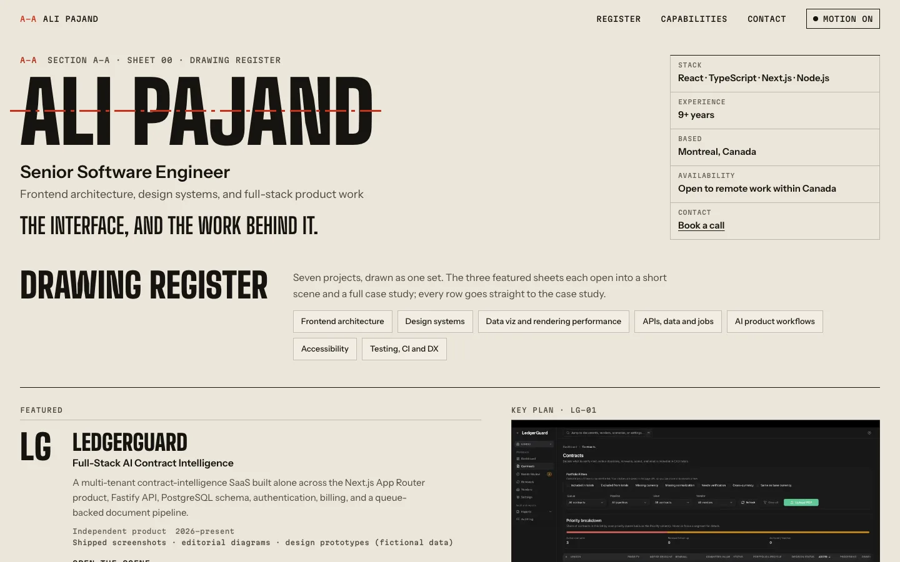
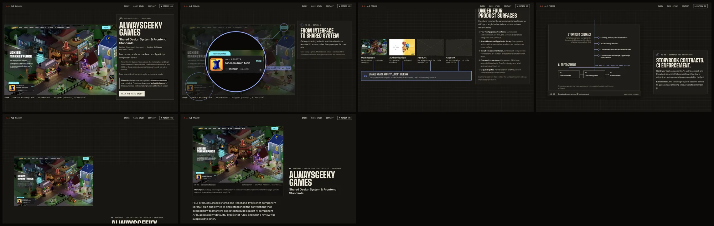
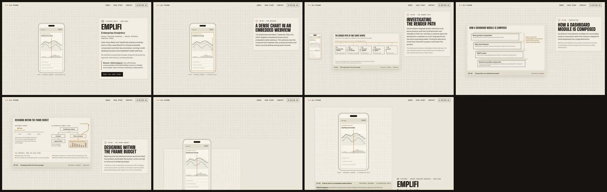

# P2 · Design-system portability

> Design artefact only. No production code, dependency, configuration, token or content changes. Nothing here is approved for production, and production implementation has not started. Branched from the reviewed head of [#215](https://github.com/alipajand/alipajand/pull/215) (`33c51a9`), which stays unmerged.

**The question:** can the Section A–A visual language carry the whole engineering portfolio, and not only LedgerGuard?

**P2.1** is the revision after the design review on this PR. It redesigns the index's first frame and mobile register, corrects the Emplifi drawings, refines the AlwaysGeeky contract beat and both match cuts, and makes the flat LedgerGuard path the default. The self-critique (06) concludes the creative work is **not finished**: the first frame's drawing is distinctive, but its type and labels still read as generic editorial design.

**The proposal:** every project is a **sheet in one drawing set**. The set shares paper, type, three provenance materials, sheet codes, navigation and one motion contract. Each project gets **one drafting move and one ink**, about its own work:

- **LedgerGuard** keeps the section cut, in red. The red review boundary stays LedgerGuard's alone.
- **AlwaysGeeky** gets the detail callout, in blue. Its scene descends from a part of the shipped (now historical) Voxies marketplace to the shared library, then along one line through the Storybook contract to CI enforcement.
- **Emplifi** gets the probe and the reference ruler, in ochre. Its scene has no screenshots and shows technique, not magnitude: where the render path was investigated, and how the work was composed to fit a frame. No drawing shows a measured or comparative value.

**Dark only.** After P2.1 the prototype moved to a single dark palette: light ink on a warm near-black paper, screenshots on a deeper void. There is no light theme. The tokens and contrast ratios are in 01. The P1 LedgerGuard pages under `cinematic-exploration/` are unchanged and still light. The stills and storyboards are recaptured in dark; the `compare-*` before/after images record the P2.1 revision and keep the earlier light palette.

The **index** opens on a section through the three featured projects, cut on the A–A line: the interface above, the work behind it below. With motion on, it condenses, pinned, into the register's top row. Every one of the seven projects is one link from the index; scenes are always optional.

> **Provenance.** Shipped screenshots sit on dark plates. Editorial diagrams say "illustrative data" or "schematic" where true. LedgerGuard's design prototypes keep their dashed frames and "fictional data" labels. On the index, the cut band names both materials for every bay. No Storybook screen, Emplifi interface or measured value is shown or implied. No percentage figure appears anywhere.







## Deliverables

| #   | Deliverable                  | Where                                                                                                                                                                                                                                                                                                 |
| --- | ---------------------------- | ----------------------------------------------------------------------------------------------------------------------------------------------------------------------------------------------------------------------------------------------------------------------------------------------------- |
| 1   | Revised interactive index    | [`prototype/index.html`](prototype/index.html), [`prototype/opening.css`](prototype/opening.css), [`prototype/register.js`](prototype/register.js); spec in [01](01-design-system.md#the-portfolio-index-a-section-through-the-work) and [02](02-motion-grammar.md#the-opening-a-pinned-condensation) |
| 2   | Updated mobile register      | Stills `screenshots/mobile-0*-index-*`, full page `screenshots/mobile-05-index-full.webp`                                                                                                                                                                                                             |
| 3   | Corrected Emplifi sequence   | [`prototype/emplifi.html`](prototype/emplifi.html); beats in [03](03-scenes.md#emplifi--technique-not-magnitude)                                                                                                                                                                                      |
| 4   | Refined AlwaysGeeky sequence | [`prototype/alwaysgeeky.html`](prototype/alwaysgeeky.html); beats in [03](03-scenes.md#alwaysgeeky--from-the-interface-to-the-component-system-under-it)                                                                                                                                              |
| 5   | Corrected match cuts         | [02](02-motion-grammar.md#the-match-cut-precisely); frames reviewed in [05](05-review.md)                                                                                                                                                                                                             |
| 6   | Before/after screenshots     | After: [`screenshots/`](screenshots/). Before (P2): [`screenshots/before/`](screenshots/before/). Side by side: `screenshots/compare-*.webp`                                                                                                                                                          |
| 7   | Desktop motion recordings    | [`recordings/desktop-full.mp4`](recordings/desktop-full.mp4) and clips 01–05 below; before: [`recordings/before/`](recordings/before/)                                                                                                                                                                |
| 8   | Mobile motion recordings     | [`recordings/mobile-full.mp4`](recordings/mobile-full.mp4), `mobile-index`, `mobile-alwaysgeeky`, `mobile-emplifi`                                                                                                                                                                                    |
| 9   | Reduced-motion captures      | [`recordings/reduced-motion.mp4`](recordings/reduced-motion.mp4); stills `screenshots/*-reduced-*`                                                                                                                                                                                                    |
| 10  | Updated design-system docs   | [01](01-design-system.md), [02](02-motion-grammar.md), [03](03-scenes.md), [04](04-compatibility-and-performance.md)                                                                                                                                                                                  |
| 11  | Updated review and critique  | [05](05-review.md), [06](06-comparison-and-critique.md), [`capture/review-results.json`](capture/review-results.json)                                                                                                                                                                                 |

### Clips

Desktop, 1440 × 900:

1. [01-index.mp4](recordings/01-index.mp4): the first frame, the pinned condensation into the register, bay focus, supporting work and a discipline mark, then into the AlwaysGeeky scene
2. [02-alwaysgeeky-scene.mp4](recordings/02-alwaysgeeky-scene.mp4): detail, assembly, then one move down to the contract and enforcement
3. [03-alwaysgeeky-match-cut.mp4](recordings/03-alwaysgeeky-match-cut.mp4): the marketplace screenshot into the case study's hero
4. [04-emplifi-scene.mp4](recordings/04-emplifi-scene.mp4): the webview, the render path, composition, the frame budget
5. [05-emplifi-match-cut.mp4](recordings/05-emplifi-match-cut.mp4): the webview drawing into the hero, clear of the heading

Phone, 390 × 844: [mobile-index.mp4](recordings/mobile-index.mp4), [mobile-alwaysgeeky.mp4](recordings/mobile-alwaysgeeky.mp4), [mobile-emplifi.mp4](recordings/mobile-emplifi.mp4).

The recordings are headless Chromium, except the one marked WebKit, which is headless WebKit. **Neither is shipping Safari.** The cursor dot is added by the recorder for legibility and is not part of the prototype.

## What changed in the P1 prototype

P2 touches the P1 LedgerGuard prototype in [`../cinematic-exploration/prototype/`](../cinematic-exploration/prototype/) in two ways only:

- **Review captions**, as the design review asked: "0 of 13 terms confirmed. Review required.", "6 of 13 terms confirmed. 7 await review." and "13 of 13 terms confirmed. Review complete.". Each is marked "Prototype state · fictional data".
- **Flat depth by default.** Every engine gets the non-3D "drawn section". The 3D anatomy runs only with `?depth=3d`, for review. No user-agent API is read. The 3D path stays an **unresolved shipping blocker** (see 04).

## Run it locally

The pages are static HTML, CSS and JS. GSAP 3.12.5 and ScrollTrigger load from cdnjs, and fonts load from Google Fonts. Serve the `portfolio-redesign` folder, so that P2 can link to the P1 LedgerGuard pages:

```bash
python3 -m http.server 4417 --directory docs/design/portfolio-redesign
```

Then open <http://localhost:4417/p2-portability/prototype/index.html>.

### Rebuild the pages from project data

`prototype/build.mjs` reads `data/projects.ts` and writes the three pages. It needs Node 23.6 or later, which strips TypeScript types without a flag.

```bash
node --no-warnings docs/design/portfolio-redesign/p2-portability/prototype/build.mjs
```

### Capture scripts

`capture/` holds the scripts that produced the evidence: `review.mjs` (05), `record.mjs` (the recordings), `stills.mjs` (the screenshots) and `perf.mjs` (04). They need `playwright-core` and `axe-core` on `NODE_PATH`, a Chromium build at `CHROME_PATH` and ffmpeg on `PATH`. WebKit runs need a Playwright install that includes WebKit, on `ENGINES_NODE_PATH`. None of these are project dependencies, and none were added to `package.json`.
